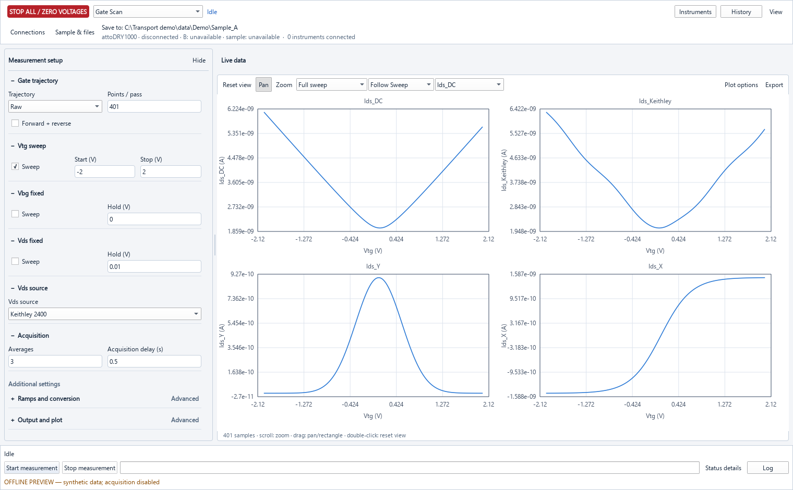
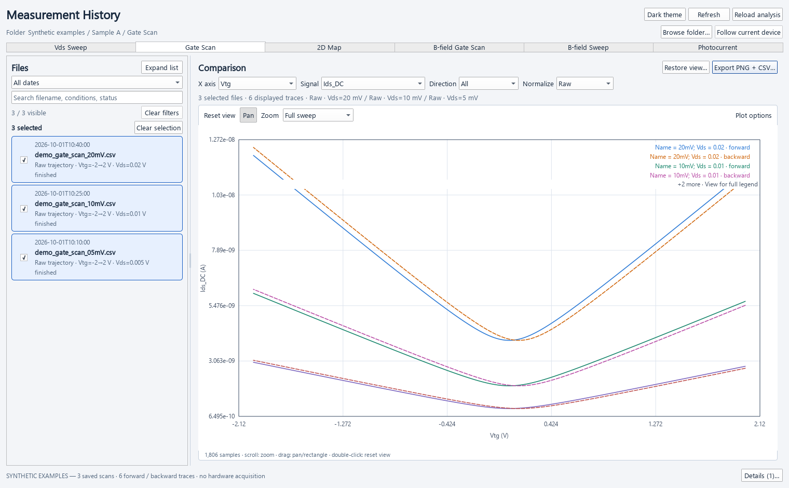

# Transport Measurement

**English** | [简体中文](README.zh-CN.md)

Windows desktop software for electrical transport and photocurrent measurements,
with coordinated instrument control, live plots, CSV recording, and independent
history analysis. The default interface uses PySide6 / Qt Quick.

[](https://github.com/ylylyl98/Transport_Pyside6/actions/workflows/windows.yml)
[](https://github.com/ylylyl98/Transport_Pyside6/releases/latest)

**[Download for Windows x64](https://github.com/ylylyl98/Transport_Pyside6/releases/latest)**
· [Installation and configuration](docs/user-setup.md)
· [Documentation](docs/README.md)
· [Report an issue](https://github.com/ylylyl98/Transport_Pyside6/issues)



*Actual application interface with synthetic data in a hardware-blocked preview.*

## Quick start: Windows installer

1. Open the [latest release](https://github.com/ylylyl98/Transport_Pyside6/releases/latest)
   and download **`Transport-Setup-windows-x64.exe`** from Assets.
2. Run the installer for your Windows account; no administrator access is required.
   Launch **Transport Measurement** from the Start menu (desktop shortcut optional).
3. Install the drivers needed by your instruments, then follow the
   [first-time configuration guide](docs/user-setup.md#3-configure-the-first-session)
   before connecting hardware.

The default installation folder is `%LOCALAPPDATA%\Programs\Transport Measurement`.
The portable **`Transport-windows-x64.zip`** remains available: extract the entire
ZIP and run `Transport/Transport.exe`, keeping `TransportWorker.exe`, `_internal`,
and all bundled files together. `SHA256SUMS.txt` covers both downloads. See the
[setup guide](docs/user-setup.md) for checksums, updates, and uninstallation.

While Transport is open, it checks official GitHub releases in the background and
shows a banner when a newer version is available. In Qt Quick, use
**View → Check for updates** to check manually, or disable
**View → Check for updates automatically**. In Widgets, the corresponding Tools
items are **Check for updates...** and **Automatically check for updates**. Updates
are downloaded and installed manually after measurements and cleanup finish;
there is no automatic installation or restart. Older versions without this
feature need one manual update first. Closing the app stops checks; there are no
system push notifications. See the setup guide for details.

The EXE includes Python and its application packages. You do **not** need to
install Python, Git, PySide6, NumPy, or Matplotlib to use this download. System
instrument drivers and optional vendor SDKs are installed separately.

## What you need to install

Install only the components required by your setup. Choose drivers compatible
with your Windows version, instrument model, and the x64 application.

| Your use case | Install separately |
| --- | --- |
| Open the EXE or inspect saved measurements | The installer or complete portable ZIP; no separate Python environment. |
| NI DAQ acquisition or analog output | [NI-DAQmx](https://www.ni.com/en/support/downloads/drivers/download.ni-daq-mx.html) driver/runtime for the device. |
| Keithley, SRS lock-in, SP-2300, APS100, or LS335 through VISA | A compatible VISA implementation, such as [NI-VISA](https://www.ni.com/en/support/downloads/drivers/download.ni-visa.html). |
| NI GPIB adapter/controller | [NI-488.2](https://www.ni.com/en/support/downloads/drivers/download.ni-488-2.html). Other brands need their own supported driver. |
| USB-to-serial adapter | The adapter manufacturer's Windows driver, when required. |
| attoDRY2100 | The vendor's Python SDK, with its directory and device address configured. SDK version and packaged-app compatibility require validation with your system; see the [setup guide](docs/user-setup.md). |
| Run or develop from source | [Python](https://www.python.org/downloads/windows/) x64; the project validates with **3.13.9**. [Git](https://git-scm.com/downloads/win) is needed for cloning/synchronization. The launcher installs the Python packages. |

**The bundled `pyvisa` and `nidaqmx` Python packages do not replace NI-VISA and
NI-DAQmx system drivers.** Download links, installation checks, configuration
examples, and troubleshooting are in the [setup guide](docs/user-setup.md).

## Measurement and analysis

| Measurement mode | Purpose |
| --- | --- |
| **Vds Sweep** | Sweep drain-source bias while holding the gate biases; select Keithley or NI DAQ AO as the Vds source. |
| **Gate Scan** | Sweep raw gate voltages or a derived Doping / E-field trajectory, with an optional reverse pass. |
| **2D Map** | Acquire a 1D trajectory or 2D grid with selectable fast/slow axes in raw or derived coordinates. |
| **Photocurrent** | Sweep SP-2300 wavelength for enabled gate-bias recipe conditions. |
| **B-field Gate Scan** | Repeat gate scans at a sequence of APS100 magnetic-field targets. |
| **B-field Sweep** | Sweep APS100 field between endpoints for fixed bias conditions, with optional round trips. |

Live plots support channel selection and a four-channel view. **History** opens
an independent viewer for saved curves, maps, measured line cuts, normalization,
and comparison. Analysis can export PNGs and companion CSVs without changing the
original measurements. See the [measurement guide](docs/measurement-guide.md)
and [history and export guide](docs/history-and-export.md).



*History preview using synthetic files; no laboratory data is shown.*

## First measurement and safety

> **Laboratory software:** connecting instruments can change their outputs.
> Check wiring, addresses, source modes, voltage limits, and current compliance
> before connecting. Software checks do not replace laboratory procedures or
> hardware interlocks.

1. Open **Connections**, scan/select the actual device addresses, and review
   source modes and protection settings. Clear unused device addresses before
   **Connect all**, then confirm the required instruments' status and readback.
2. Open **Sample & files**. Set your operator name, sample ID, and a writable
   data folder. Review signal conversion and channel mappings for your wiring.
3. Select a measurement mode, set the trajectory, timing, averaging, and output
   name, then review the planned sweep before starting.
4. Monitor the live plot and status. After a stop request, wait for instrument
   operations and cleanup to complete. **STOP / zeroing does not mean the
   magnetic field is zero.**
5. Inspect the saved CSVs and use **History** to compare or export results.

Data is stored below `<data folder>/<operator>/<sample ID>/`, with subfolders
and metadata depending on the measurement. Choose your own data location;
the source defaults are laboratory examples. Preserve data and user settings
when updating. Detailed [safety behavior](docs/measurement-guide.md#safety-behavior)
includes the different Keithley and DAQ disconnect/zeroing behavior.

## Run from source

Install a compatible Python x64 interpreter on `PATH` (Python **3.12–3.14** is
accepted; **3.13.9** is the CI baseline), then run in PowerShell:

```powershell
git clone https://github.com/ylylyl98/Transport_Pyside6.git
cd Transport_Pyside6
.\Transport_App.bat
```

The root launcher creates/reuses `.venv`, installs the pinned
[requirements](requirements.txt) when needed, and performs an isolated startup
check after relevant changes. Use the root checkout for development; utilities
and backups are not alternative production copies. Details are in the
[setup guide](docs/user-setup.md) and [developer notes](docs/developer-notes.md).

For the retained Widgets interface, close normally while idle. In PowerShell,
run `.\Transport.exe --widgets` from the installation folder (normally
`$env:LOCALAPPDATA\Programs\Transport Measurement`) or extracted `Transport` folder, or
`.\Transport_App.bat --widgets` from the source checkout.

## Tests, releases, and help

GitHub Actions runs all offline test modules on separate Windows runners, builds
the EXE, and exercises the packaged application. Pushes to `main` and pull
requests produce downloadable Actions artifacts; `v*` tags publish the verified
installer, portable ZIP, and checksums. GUI modules run sequentially within each runner;
separate runners provide parallelism. These software checks use simulated
hardware and **do not certify physical instruments**.

| Documentation | Contents |
| --- | --- |
| [User setup](docs/user-setup.md) / [中文](docs/user-setup.zh-CN.md) | Downloads, drivers, configuration, updates, and troubleshooting. |
| [Measurement guide](docs/measurement-guide.md) | Sweep controls, live plots, data output, and safety behavior. |
| [History and exports](docs/history-and-export.md) | Comparison, maps/cuts, normalization, PNG and CSV exports. |
| [Tests and releases](docs/github-release.md) | CI, artifacts, checksums, and version-tag releases (Chinese). |
| [Developer notes](docs/developer-notes.md) | Source layout, launch behavior, and implementation details. |
| [Documentation index](docs/README.md) | Instrument guides, migration notes, and dated audit records; languages are labeled. |

For a problem, [open an issue](https://github.com/ylylyl98/Transport_Pyside6/issues)
with the release version, Windows version, launch method, relevant instrument
and driver versions, error text, and steps to reproduce. Remove personal paths
and sensitive measurement data from shared logs and screenshots.

## License

No project license file is currently included. Do not assume permission to
redistribute or reuse the code until the project owner adds a license.
